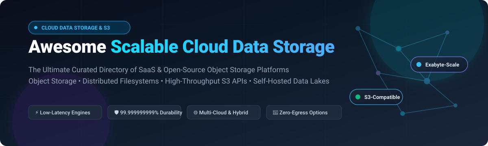

# ☁️ Awesome Scalable Cloud Data Storage 

  

  <strong>A curated collection of scalable cloud data storage platforms, distributed filesystems, high-throughput S3-compatible APIs, and self-hosted data lake infrastructure.</strong>

  <a href="#-sector-overview--market-dynamics">Sector Overview</a> •
  <a href="#-saas--hosted-platforms">SaaS Platforms</a> •
  <a href="#-open-source-github-projects">Open-Source Projects</a> •
  <a href="#-comparison-matrix--quick-reference">Comparison Matrix</a> •
  <a href="#-how-to-contribute">Contributing</a>

---

## 🔍 SEO & Technology Keywords

`cloud-storage` • `object-storage` • `s3-compatible` • `distributed-storage` • `blob-storage` • `data-lake` • `hybrid-cloud` • `ceph` • `minio` • `seaweedfs` • `cloud-infrastructure` • `unstructured-data`

---

## 📊 Sector Overview & Market Dynamics

The global **Cloud Data Storage and Object Storage market** is estimated at **$132.5 Billion in 2026** (projected to reach **$380+ Billion by 2033** at a ~17.5% CAGR), supercharged by modern AI model training runs, high-throughput vector embedding stores, and enterprise multimodal analytics lakes. 

The sector is **moderately concentrated at the hyperscaler infrastructure layer**—dominated by AWS S3, Google Cloud Storage, and Microsoft Azure Blob—yet experiences **rapid vertical fragmentation** driven by zero-egress specialists (Cloudflare R2, Wasabi, Backblaze B2) and specialized high-throughput AI storage appliances (Pure Storage FlashBlade, MinIO Enterprise AIStor). Modern architecture decisions increasingly favor hybrid topologies where S3-compliant APIs act as the universal standard for multicloud portability and disaster recovery.

---

## 📑 Table of Contents

- [☁️ SaaS & Hosted Platforms](#-saas--hosted-platforms)
- [💻 Open-Source GitHub Projects](#-open-source-github-projects)
- [🧭 Decision & Architecture Guide](#-decision--architecture-guide)
- [🤝 How to Contribute](#-how-to-contribute)
- [⚠️ Disclaimer](#-disclaimer)

---

## ☁️ SaaS & Hosted Platforms

The table below outlines leading commercial cloud object and scalable storage providers, sorted in descending order by **Company Valuation / Market Cap**.

| Company / Product | Valuation / Revenue | Starting Tier Pricing | Free Tier / Free Trial Limits | Key Architecture Focus |
| :--- | :--- | :--- | :--- | :--- |
| **[Microsoft Azure Blob Storage](https://azure.microsoft.com/en-us/products/storage/blobs)** | **$3.1T+** Market Cap | **$0.018/GB/month** (Hot LRS tier; $0.00099/GB archive) | **5 GB LRS Hot** free for 12 months + 20,000 read / 10,000 write operations | Multi-tier unstructured blob storage integrated with Azure Data Lake Storage (ADLS Gen2) & Azure AI. |
| **[Amazon S3](https://aws.amazon.com/s3/)** *(AWS / Amazon)* | **$2.0T+** Market Cap | **$0.023/GB/month** (Standard first 50 TB; $0.00099/GB Glacier Deep Archive) | **5 GB Standard Storage** free for 12 months + 20,000 GET / 2,000 PUT requests + 100 GB egress/mo | Industry benchmark object storage offering 99.999999999% (11 9s) durability and granular S3 lifecycle policies. |
| **[Google Cloud Storage](https://cloud.google.com/storage)** *(Alphabet)* | **$2.0T+** Market Cap | **$0.020/GB/month** (Standard storage multi-region; $0.0012/GB Archive) | **5 GB Standard Storage/month free forever** (US regions) + 5,000 Class A / 50,000 Class B ops + 100 GB egress | Strongly consistent distributed object storage built natively into BigQuery, Vertex AI, and Google Cloud services. |
| **[IBM Cloud Object Storage](https://www.ibm.com/cloud/object-storage)** | **$200B+** Market Cap | **$0.022/GB/month** (Standard Smart Tier; $0.002/GB Cold Vault) | **25 GB/month free forever** (Lite plan, no credit card required) + 20,000 PUT & 200,000 GET requests | Geo-dispersed information dispersal algorithms (IDA) engineered for strict enterprise compliance and zero single-points-of-failure. |
| **[Cloudflare R2](https://www.cloudflare.com/developer-platform/r2/)** | **$35B+** Market Cap | **$0.015/GB/month** + **$0.00 egress fees** ($0.36/M Class A ops, $0.036/M Class B ops) | **10 GB/month free forever** + 1,000,000 Class A ops + 10,000,000 Class B ops/month | Zero-egress-fee S3-compatible edge storage natively integrated with Cloudflare Workers and globally distributed CDN. |
| **[Snowflake Storage Layer](https://www.snowflake.com/)** | **$45B+** Market Cap | **$23.00/TB/month** ($0.023/GB compressed, capacity priced at wholesale ~$40/TB on-demand) | **30-day free trial with $400 free usage credits** (storage + compute) | Decoupled hybrid-columnar storage layer driving Snowflake’s unified Data Cloud, Iceberg tables, and automatic compression. |
| **[Pure Storage FlashBlade](https://www.purestorage.com/)** | **$16B+** Market Cap | **$0.08/GB/month equivalent** (Pure1 / Evergreen//One unified fast file & object subscription) | **90-day guided POC trial** with dedicated test array access / Pure1 lab environment | High-performance all-flash scale-out hardware & hybrid cloud storage fabric optimized for AI cluster training & real-time analytics. |
| **[Backblaze B2](https://www.backblaze.com/cloud-storage)** | **$350M+** Market Cap | **$0.006/GB/month** (~$6/TB) + free egress up to 3x monthly storage volume | **10 GB storage free forever** + unlimited free uploads + 1 GB free download egress per day | Low-cost S3-compatible storage engineered for enterprise backups, long-term archives, and multimedia repositories. |
| **[Wasabi Technologies](https://wasabi.com/)** | **$1.1B** Valuation | **$0.0069/GB/month** ($6.99/TB/month flat) with **$0 egress & $0 API request fees** | **30-day free trial with up to 1 TB full storage capacity** (no egress charges) | Predictable flat-rate hot cloud object storage designed without egress fees or tiering complexity. |
| **[MinIO (Commercial AIStor)](https://min.io/)** | **$1.0B+** Valuation | **$0.020/GB/month** (Enterprise AIStor tier starting at $20/TB/month for dedicated multi-node clusters) | **30-day free commercial enterprise evaluation license** with full enterprise subnet support | High-throughput, Kubernetes-native enterprise object storage designed specifically for high-speed AI pipelines and GPU architectures. |

---

## 💻 Open-Source GitHub Projects

The following self-hosted object stores, distributed filesystems, and data lake layers are sorted in descending order by **GitHub Star Count**. Star badges link directly to the stargazers page of each repository.

| Project | Stars | Language | License | Primary Architectural Use Case |
| :--- | :--- | :--- | :--- | :--- |
| **[MinIO](https://github.com/minio/minio)** |  | Go | AGPL-3.0 | The de facto standard S3-compatible object store. Single binary deployment with rich API support (*note: community releases in maintenance mode; see forks*). |
| **[Rclone](https://github.com/rclone/rclone)** |  | Go | MIT | Universal cloud storage data sync engine and virtual S3 file system mounter supporting 70+ cloud storage backends. |
| **[SeaweedFS](https://github.com/seaweedfs/seaweedfs)** |  | Go | Apache-2.0 | High-performance distributed filesystem based on Facebook's Haystack design, optimized for billions of small files and POSIX/S3 workloads. |
| **[RustFS](https://github.com/rustfs/rustfs)** |  | Rust | Apache-2.0 | Next-generation drop-in MinIO alternative built in Rust with high memory safety, asynchronous I/O, and native S3 gateway compatibility. |
| **[Ceph](https://github.com/ceph/ceph)** |  | C++ | LGPL-2.1 | Battle-tested, exabyte-scale unified software-defined storage cluster providing unified Object (RGW), Block (RBD), and POSIX Filesystem (CephFS). |
| **[JuiceFS](https://github.com/juicedata/juicefs)** |  | Go | Apache-2.0 | High-performance POSIX distributed file system built over object storage (S3, GCS, OSS, Ceph) with Redis/SQL metadata management. |
| **[Rook](https://github.com/rook/rook)** |  | Go | Apache-2.0 | Cloud-native storage orchestrator for Kubernetes; automates deployment, scaling, bootstrapping, and self-healing of Ceph clusters. |
| **[s3fs-fuse](https://github.com/s3fs-fuse/s3fs-fuse)** |  | C++ | GPL-2.0 | FUSE-based filesystem allowing Linux, macOS, and containerized workloads to mount Amazon S3 or S3-compatible buckets as local filesystems. |
| **[OpenEBS](https://github.com/openebs/openebs)** |  | Go / Rust | Apache-2.0 | Container Attached Storage (CAS) for Kubernetes, providing persistent, distributed dynamic block and object storage engines across clouds. |
| **[Longhorn](https://github.com/longhorn/longhorn)** |  | Go | Apache-2.0 | Cloud-native distributed block storage built for Kubernetes with built-in disaster recovery, incremental snapshots, and S3-target backup replicas. |
| **[Alluxio](https://github.com/alluxio/alluxio)** |  | Java | Apache-2.0 | Open-source data orchestration and memory-speed caching layer that bridges analytical compute frameworks (Presto, Spark, PyTorch) with object stores. |
| **[lakeFS](https://github.com/treeverse/lakeFS)** |  | Go | Apache-2.0 | Git-like version control interface for object storage data lakes; enables atomic branching, commits, merges, and rollbacks on top of S3, GCS, and Azure Blob. |
| **[GlusterFS](https://github.com/gluster/glusterfs)** |  | C | GPL-2.0 / LGPL-3.0 | Scalable network-attached distributed filesystem capable of aggregating disk storage building blocks into a unified parallel storage volume. |
| **[Garage](https://github.com/deuxfleurs-org/garage)** |  | Rust | AGPL-3.0 | Lightweight distributed S3 object store written in Rust; engineered to run resiliently across multi-datacenter edge topologies using CRDTs. |
| **[Dragonfly2](https://github.com/dragonflyoss/Dragonfly2)** |  | Go | Apache-2.0 | CNCF intelligent P2P-based file distribution and image/blob sharing system for high-throughput cloud-native environments. |
| **[Storj (storj-node)](https://github.com/storj/storj)** |  | Go | AGPL-3.0 | Decentralized, peer-to-peer S3-compatible cloud storage network providing zero-knowledge client-side encryption and high geographic redundancy. |
| **[VersityGW](https://github.com/versity/versitygw)** |  | Go | Apache-2.0 | High-performance modular S3 gateway enabling applications to expose local POSIX filesystems, Ceph, or backend block storage through standard S3 REST endpoints. |
| **[OpenStack Swift](https://github.com/openstack/swift)** |  | Python | Apache-2.0 | High-scale, durable, distributed object storage system designed for storing massive amounts of unstructured data across multi-rack physical hardware. |
| **[MooseFS](https://github.com/moosefs/moosefs)** |  | C | GPL-2.0 | Fault-tolerant, highly available distributed POSIX network filesystem with dynamic file tiering, erasure coding, and transparent data replication. |
| **[Scality S3 Server](https://github.com/scality/cloudserver)** |  | JavaScript | Apache-2.0 | Scality's open-source S3 API gateway implementation in Node.js, providing full AWS S3 protocol compatibility for private clouds. |
| **[Apache Ozone](https://github.com/apache/ozone)** |  | Java | Apache-2.0 | Highly scalable distributed object store for big data ecosystems; resolves Hadoop HDFS small-file bottleneck while providing native S3 compatibility. |
| **[Pigsty MinIO Revival](https://github.com/Vonng/minio)** |  | Go | AGPL-3.0 | Community revival and maintenance fork of MinIO preserving the AGPLv3 embedded management console and enterprise deployment automation. |
| **[Nexo](https://github.com/R3n3r0/Nexo)** |  | Go | AGPL-3.0 | Modern self-hosted S3-compatible object storage featuring web console, dynamic image transformation (AVIF, WebP), clustering, and custom CDN domains. |

---

## 🧭 Decision & Architecture Guide

When choosing or deploying a cloud data storage solution, consider the following trade-offs:

1. **Egress Costs vs. Hyperscaler Integration**:
   - If your applications generate immense read bandwidth across the public internet (video streaming, software downloads, AI datasets), evaluate zero-egress specialists such as **Cloudflare R2**, **Wasabi**, or **Backblaze B2**.
   - If your pipeline deeply depends on managed analytics (e.g., Athena, EMR, BigQuery, Snowflake), standard hyperscaler storage (**AWS S3**, **GCS**, **Azure Blob**) minimizes inter-service latency.

2. **Enterprise Durability vs. Operational Simplicity**:
   - **Ceph** provides complete multi-protocol flexibility (Block, POSIX, Object) with zero vendor lock-in, but requires dedicated Linux and storage systems administrators.
   - **SeaweedFS** excels at billions of tiny objects with O(1) disk lookups, but demands careful sizing of external metadata stores.
   - **Garage** and **VersityGW** present ultra-lean footprints for edge deployments, single-node gateways, or small self-hosted dev clusters where full AWS IAM semantics are not mandatory.

---

## 🤝 How to Contribute

Contributions are welcome! To suggest or add a new SaaS platform or open-source storage tool:

1. 🍴 Fork the repository.
2. 📝 Edit `README.md` keeping the tabular format and verified factual descriptions.
3. ⭐ Ensure open-source projects include a valid stargazers link badge.
4. 🚀 Submit a Pull Request detailing the advantages, license, and architectural highlights of the proposed project.

---

## ⚠️ Disclaimer

- This repository is a community-curated list for informational and architectural evaluation purposes.
- All pricing models, free tier limits, and market capitalizations reflect publicly published figures as of late 2026 and are subject to change by respective vendors.
- Self-hosting production storage clusters requires strict adherence to replication, erasure coding, backup topologies, and security policies.

---

  Curated with care for storage architects, DevOps engineers, and cloud infrastructure builders worldwide.

